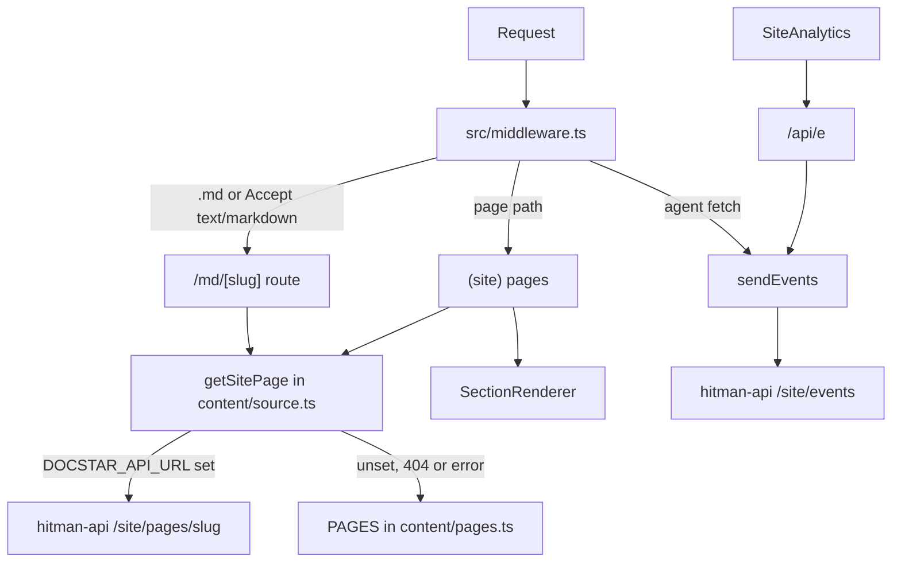

# Architecture

Next.js 15 App Router site. Pages are **data**: ordered lists of typed sections in `src/content`, rendered to HTML by `SectionRenderer` and to markdown by `renderPageMarkdown`. Live content optionally comes from hitman-api; the bundled copy is the fallback. Dynamic routes run on the edge runtime (Cloudflare Pages).

## Entry points
- `src/app/layout.tsx`: root layout. Sets `runtime = "edge"`, global SCSS, Google Tag Manager.
- `src/app/(site)/layout.tsx`: wraps pages in `SiteNav`, `SiteFooter`, `SiteAnalytics` and the `.ds-site` scope.
- `src/app/(site)/page.tsx`: home (slug `home`). `src/app/(site)/[...slug]/page.tsx`: every other page, resolved through `PATH_TO_SLUG`.
- `src/middleware.ts`: markdown twins, server-side agent analytics, anonymous-visitor cookie, logged-in redirect from `/` to the app.

## Content model (single source of truth)
- Types: `src/content/types.ts` (`Section` union, `SitePage`, `Cta`).
- Pages: one file per page in `src/content/pages/`, home in `src/content/home.ts`; registered in `PAGES` in `src/content/pages.ts`. Adding a page means adding it to `PAGES`; routing, sitemap, `llms.txt`, markdown twins and middleware all derive from it.
- Site chrome and the shared agent prompt: `src/content/site.ts` (`SITE`). The prompt text lives only here. Footer columns are `SITE.footer` (`FooterLink`). A footer link with `newTab: true` opens in a new tab (`target="_blank"` `rel="noopener"`). Other footer links stay in the same tab. Nav links are unchanged.
- Rendering: `src/components/site/SectionRenderer.tsx` switches on `section.type` to components in `src/components/site/sections/Sections.tsx`. A new section type needs the type, a component, a renderer case and a markdown branch in `src/content/markdown.ts`.

## Content sourcing
`getSitePage` (`src/content/source.ts`) fetches `${DOCSTAR_API_URL}/site/pages/<slug>` with 60 s revalidation (`REVALIDATE_SECONDS`). In draft mode it sends `x-preview-secret` and skips the cache. On 404, error or unset URL it returns the bundled page, so the site never renders empty.

## Agent-facing outputs
- `/<page>.md`, `/index.md`, and `Accept: text/markdown`: `src/app/md/[slug]/route.ts`.
- `/llms.txt`, `/llms-full.txt`, `/content.json`, `/sitemap.xml` (merges site pages with published help and blog URLs from api.docstar.io), `/mcp/quickstart.md` (static file in `public/mcp`).

## State ownership
No client state library. Only local component state (copy-button feedback in `CtaButton`) and the analytics queue in `src/lib/analytics.ts`.

## Styling layers
See [DESIGN.md](DESIGN.md). Website UI uses CSS modules plus `src/components/site/site.css`; `src/scss/*` and Tailwind are legacy global layers.
