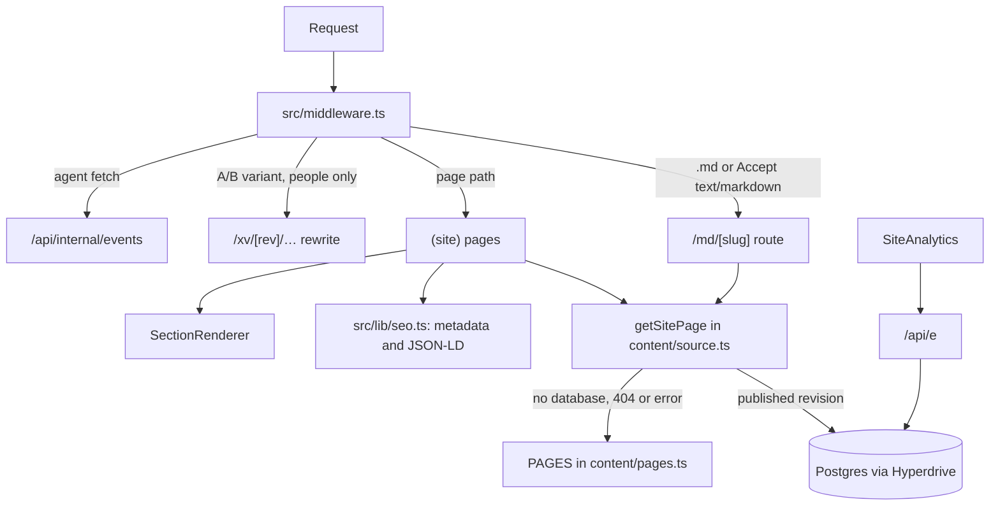

# Architecture

Next.js 15 App Router site on Cloudflare Workers (OpenNext, `wrangler.jsonc`).

Pages are **data**: ordered lists of typed sections in `src/content`, rendered to HTML by `SectionRenderer` and to markdown by `renderPageMarkdown`. The live copy of a page is its published revision in the site's own Postgres database (through Hyperdrive), edited in `/admin`. The bundled copy in `src/content` is the fallback.

## Entry points
- `src/app/layout.tsx`: root layout: default metadata, viewport, Google Tag Manager. No global CSS.
- `src/app/(site)/layout.tsx`: wraps website pages in the skip link, `SiteNav`, `<main id="main">`, `SiteFooter`, `SiteAnalytics` and the `.ds-site` scope. It loads `reset.css` and `site.css`.
- `src/app/(site)/page.tsx`: home (slug `home`). `src/app/(site)/[...slug]/page.tsx`: every other page, resolved through `PATH_TO_SLUG`, with visible breadcrumbs on paths two or more levels deep.
- `src/app/admin/*`: the internal admin (client-rendered). It alone loads Tailwind and `src/scss`.
- `src/middleware.ts`:
  - markdown twins;
  - 301s for `/md/<slug>` and uppercase page paths;
  - server-side agent analytics;
  - the anonymous-visitor cookie;
  - A/B rewrites;
  - the logged-in redirect from `/`;
  - noindex on `test.*` hosts.

## Content model (single source of truth)
- **Types:** `src/content/types.ts` (`Section` union, `SitePage`, `Cta`). The database schema mirrors them in `src/server/siteSchema.ts`.
- **Pages:** one file per page in `src/content/pages/`, home in `src/content/home.ts`.
  - `LIVE_PAGES` in `src/content/pages.ts` are routed.
  - `DRAFT_PAGES` (built, with TODO-COPY placeholders) are routed only with `NEXT_PUBLIC_SHOW_DRAFT_PAGES=1`.
  - `PAGES` is what routing, the sitemap, `llms.txt`, markdown twins, the OG images, the middleware and the footer read.
  - `label` (breadcrumb name) and `updated` (bundled change date) are code-only fields.
- **Site chrome and the shared agent prompt:** `src/content/site.ts` (`SITE`). The prompt text lives only here. Footer links to pages that aren't live are hidden automatically.
- **Rendering:** `src/components/site/SectionRenderer.tsx` switches on `section.type`. A new section type needs five edits:
  - the type in `types.ts`;
  - the zod schema in `siteSchema.ts`;
  - a component in `Sections.tsx`;
  - a renderer case;
  - a branch in `markdown.ts`.

## Content sourcing
- `getSitePage` (`src/content/source.ts`) reads the published revision from the database, cached for 60 s per server instance (`REVALIDATE_SECONDS`). Publishing clears that instance's cache. In draft mode (admin preview) it reads the newest draft, uncached.
- With no database, a 404 or an error, it returns the bundled page, so the site never renders empty.
- **Once a page is in the database, code edits to it don't reach the site** until someone uses Admin > page > **Load code version** and publishes. `/pricing` is never synced, so it always comes from code.

## Search and agent outputs
- **`src/lib/seo.ts`:** one place for every page's head tags and JSON-LD.
  - `pageMetadata`: absolute canonical, markdown alternate, robots, OpenGraph and Twitter with `/og/<slug>.png`.
  - `pageJsonLd`: Organization, WebSite (home), WebPage, BreadcrumbList, SoftwareApplication with offers read from the pricing page.
  - `htmlLimitedBots: /.*/` in `next.config.ts` keeps metadata in `<head>` for every client.
- `/og/<slug>.png`: share images, prerendered at build (`src/app/og/[image]/route.tsx`).
- `/<page>.md`, `/index.md`, and `Accept: text/markdown`: `src/app/md/[slug]/route.ts`. Sends `Link: rel="canonical"` to the HTML page and `Vary: Accept`.
- `/robots.txt` (`src/app/robots.ts`): served by the Worker so the test-host override applies.
- `/sitemap.xml`: live pages with their real change date, plus help and blog URLs from api.docstar.io.
- `/llms.txt`, `/llms-full.txt`, `/content.json`, and `/mcp/quickstart.md` (static file in `public/mcp`).
- `/api/tools/llms-check`: the llms.txt checker behind `/tools/llms-txt-checker` (`src/server/llmsCheck.ts`).
- **Help docs and the blog** (`docstar.io/help`, `docstar.io/blog`) are served by the DocStar product, not this app.

## State ownership
No client state library. Only local component state (copy-button feedback in `CtaButton`, the llms.txt checker form) and the analytics queue in `src/lib/analytics.ts`.

## Styling layers
See [DESIGN.md](DESIGN.md).
- Website UI uses CSS modules plus `site.css`, with `reset.css` (a cascade-layered base reset).
- `src/scss/*` and Tailwind are legacy, loaded only by `src/app/admin/layout.tsx`.
