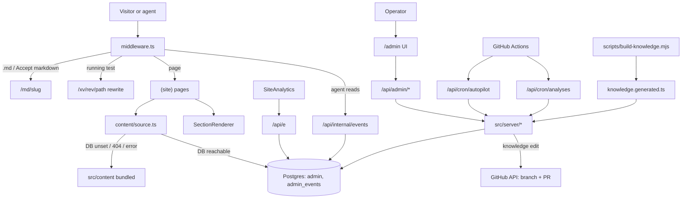

# Architecture

Next.js 15 App Router on **Cloudflare Workers** (OpenNext, `wrangler.jsonc`, custom domain docstar.io). The site is its own backend: pages are data rendered to HTML and markdown; Postgres (via Hyperdrive in production, `DATABASE_URL` locally) holds content versions, experiments, analytics events, ideas, autopilot records, knowledge edits, the competitor watchlist and analysis runs. hitman-api is **not** a content source any more.

## Entry points
- `src/app/layout.tsx` (global SCSS, GTM) and `src/app/(site)/layout.tsx` (nav, footer, `SiteAnalytics`, `.ds-site`). Pages: `(site)/page.tsx` (home) and `(site)/[...slug]/page.tsx` via `PATH_TO_SLUG`. `(site)/xv/[rev]/[[...slug]]` renders one version for experiments and operator previews.
- `src/middleware.ts`: markdown twins, server-side agent analytics, `ds_aid` cookie, experiment assignment and rewrite, `noindex` on `/admin` and `/xv`, logged-in redirect from `/` to the app. The middleware cannot open DB connections, so it calls this site's `/api/internal/*` with a key derived from `JWT_SECRET`.

## Content model
Types `src/content/types.ts`; one file per page in `src/content/pages/` (home in `home.ts`); registered in `PAGES`. A new section type needs four edits (AGENTS rule 3). `getSitePage` (`content/source.ts`): published DB version cached ~60 s per instance, draft mode reads the newest draft, falls back to bundled content when the DB is unset, missing or failing.

## Server modules (`src/server`)
`adminTypes.ts` (one generic `admin` table with typed rows: spec per type) · `content.ts` (versions: draft, publish, rollback) · `experiments.ts` (registry, launch rules, slots, results) · `events.ts` (ingest, analytics) · `knowledge.ts` (repo docs, edits, GitHub PR writeback) · `research.ts` (watchlist, source checks) · `analyses.ts` (checks, durable runs, schedule, optional AI reading) · `overview.ts` (attention list, connection status) · `settings.ts` · `autopilot/*` (daily AI agent under `policy.ts` limits) · `ideas.ts` · `auth.ts` (JWT cookie, `requireAdmin`) · `db.ts`, `http.ts`.

## Admin (`/admin`)
Client-rendered shell (`components/admin/AdminShell.tsx`), sign-in with the internal team's accounts (`npm run admin:user`); every API route calls `requireAdmin` (cookie JWT, same-origin check on writes). Sections: Overview, Knowledge, Research, Analyses, Website & experiments (Pages, Experiments, Autopilot), Analytics, Ideas & feedback, Settings. There is one role (internal operator); customer tenants have no access path here.

## Knowledge delivery
`scripts/build-knowledge.mjs` bundles `AGENTS.md` and `docs/**/*.md` with each file's git blob sha into `src/content/knowledge.generated.ts` (not committed; runs before dev and build). The admin shows that bundle as the **effective** revision. Edits become GitHub pull requests; see [FLOWS.md](FLOWS.md) flow 7.

## State ownership
Server state in Postgres. Client state is local component state plus the analytics queue. Live experiment state has one owner: the `experiment` rows.

## Schema
`db/migrations/001_init.sql` (admin, admin_events) and `002_knowledge_research_analyses.sql` (new row types and indexes: one watchlist entry per name; one queued/running run per analysis).

## Styling layers
See [DESIGN.md](DESIGN.md). Site UI: CSS modules; `src/scss` and Tailwind are legacy (the admin uses Tailwind utilities).
