# Flows

## 1. Human visits a page
Middleware classifies the request (`src/lib/requester.ts`), sets `ds_aid`, assigns experiment arms if a test runs, rewrites to `/xv/<version>/<path>` for a tested page (`private, no-store`), redirects a logged-in human from `/` to the app (`isLogin=true` cookie set by the app). The page renders from `getSitePage`. `SiteAnalytics` sends `page.viewed`, `section.viewed`, `cta.clicked`, `signup.clicked` to `/api/e`.

## 2. Visitor copies the prompt (core conversion)
`CtaButton` (`copy-prompt`) copies `SITE.prompt` and tracks `prompt.copied` with a random `ref`. The visitor's agent fetches `/mcp/quickstart.md?ref=<id>`; middleware logs `agent.quickstart_fetched` with the same `ref`. The rest of the journey (agent documents the API, visitor approves, publish) happens in the product. **Unverified from this repo:** that the quickstart works end to end and that sign-ups follow; the exact external dependency is the product's sign-up/activation data (CONTRACTS "missing").

## 3. Visitor clicks sign up
A link to `app.docstar.io/login` (nav, hero secondary, final CTA) fires `cta.clicked` and `signup.clicked`. There is no website form and no CRM handoff; success is only visible in the product.

## 4. Agent or crawler reads the site
`/<page>.md`, `/index.md` or `Accept: text/markdown` rewrites to `/md/<slug>`; `llms.txt`, `llms-full.txt`, `content.json`. Reads are logged server-side as `agent.*` events. Agents are never put in experiments.

## 5. Operator signs in (admin)
`/admin` shows a sign-in form (`ds_admin` JWT cookie, 12 h, httpOnly, SameSite strict). Every `/api/admin/*` call requires the cookie; writes also require a same-origin `Origin`. Accounts are created with `npm run admin:user`. Failed attempts are rate limited (8 per quarter hour). Without sign-in every admin API returns 401 (verified for overview, knowledge, research, analyses, settings and the cron route).

## 6. Page change and publish
Admin > Website > Pages: edit a page, save a draft version, preview (`/api/preview?path=`), publish (the previous version is superseded), roll back by copying an older version into a new published one. The page cache clears on that instance immediately and elsewhere within about a minute. A page with a running experiment is not published over.

## 7. Knowledge edit

```mermaid
sequenceDiagram
  Operator->>Admin: edit docs/X.md, Save draft / Open pull request
  Admin->>DB: knowledge_edit (draft) with baseSha
  Admin->>GitHub: read file sha on base branch
  alt sha differs from baseSha
    Admin->>DB: status conflict (not active)
  else same
    Admin->>GitHub: branch + commit + pull request
    Admin->>DB: status pending, PR url
  end
  Note over GitHub: reviewer merges, deploy runs knowledge:build
  Operator->>Admin: Check status
  Admin->>GitHub: PR merged? Admin compares deployed bundle sha
  Admin->>DB: effective (bundle contains it) or still pending
```

States: draft (saved only here; writeback not connected or not submitted), pending, effective, sync_failed, conflict, discarded. A fresh agent reads the file from the checkout after merge; nothing reads the database copy. If `GITHUB_TOKEN`/`GITHUB_REPO` are unset the admin says writeback is not connected and edits stay drafts.

## 8. Competitor research
Admin > Research: edit the watchlist, set cadence, "Check sources now" or the daily scheduler. Each source is fetched and recorded (status, title, text hash, changed flag). Interpretation is written into [COMPETITORS.md](COMPETITORS.md) by a person or agent.

## 9. Analyses
Admin > Analyses: "Run now" or the daily scheduler (`/api/cron/analyses`). One queued/running run per analysis (duplicates are skipped), two attempts, a daily budget, a pause switch, stale runs (over 15 minutes) are marked failed. Optional "Interpret with AI" is stored separately and labelled unverified; it is disabled when AI is not connected.

## 10. Experiment lifecycle
Create a draft (page, up to two draft versions as challengers, hypothesis) > fill launch fields > preview > Launch (checks readiness and the site-wide slot cap) > middleware assigns, page views carrying the arm are the exposures > results with sufficiency and guardrails > Stop / Make B or C live / Keep A. Details: [EXPERIMENTS.md](EXPERIMENTS.md).

## 11. Retired URL
`next.config.ts` maps retired help-era paths to the closest page with permanent redirects (see [SEO.md](SEO.md) for the issue with those that go to `/`).
